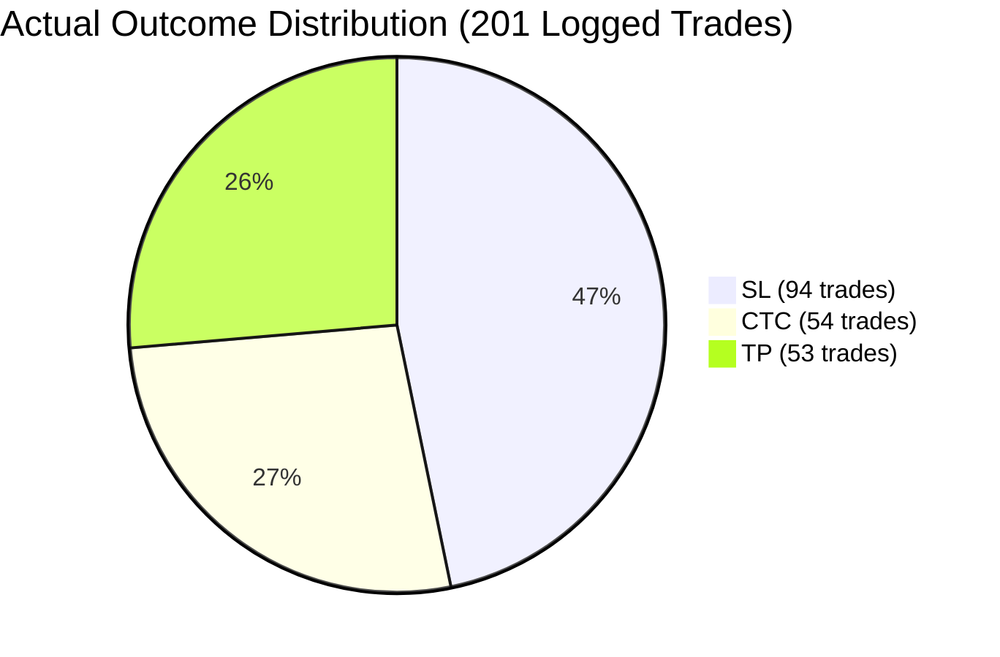

# LiquidityVision AI — Experimental Results & Evaluation

## 1. Experiment Overview

The objective of this evaluation is to analyze the **201 logged live trade records** in `live_cleaned_dataset.csv` collected through the **LiquidityVision AI** workflow, quantify empirical trade outcome distributions (`TP`, `SL`, `CTC`) with 1:3 Risk Reward across setup quality and trade direction, and assess dataset readiness for supervised model evaluation and retraining.

---

## 2. Dataset Details

- **Data Source:** `live_cleaned_dataset.csv` paired with captured chart snapshots stored under `live_dataset_images/`.
- **Dataset Size:** 201 verified post-trade records (0 missing values, 0 duplicate image paths).
- **Schema & Fields:** 4 columns — `Image_Path`, `Trade_Type` (`best`, `good`, `blind`), `Result` (`tp`, `sl`, `ctc`), and `Type` (`buy`, `sell`).
- **Date Range:** Post-trade live logging records; standardized execution timestamps are not recorded in the current CSV schema.
- **Split Methodology:** This dataset serves as an out-of-sample live operational log (`N = 201`). Before merging these records into `train_model.py` for weight updates, the dataset must be partitioned using a chronological walk-forward split or stratified train/validation/test split (e.g., 70% / 15% / 15%) after converting absolute Windows paths (`C:\Models\Model_7\...`) to relative repository paths.

| Dataset Check | Verified Result |
|---|---|
| **Total Logged Trades** | 201 |
| **Columns Present** | `Image_Path`, `Trade_Type`, `Result`, `Type` |
| **Missing / Null Values** | 0 |
| **Duplicate Image Paths** | 0 |
| **Setup Quality Distribution** | `Good`: 109 (54.23%), `Best`: 73 (36.32%), `Blind`: 19 (9.45%) |
| **Direction Distribution** | `Sell`: 117 (58.21%), `Buy`: 84 (41.79%) |

---

## 3. Model / Version

- **Model Name:** LiquidityVision AI (Multi-Modal Scalping Terminal, formerly `Model_7`)
- **Architecture Module:** `model_architecture.py` (Multi-modal vision + categorical setup network)
- **Evaluated Checkpoint:** `forex_model.pth`
- **Application Runtime:** `app_model7.py` running locally via Streamlit on `http://localhost:8507`

---

## 4. Baseline Comparison

To evaluate how user-classified setup quality and direction perform relative to the unconditional dataset average, subgroups are compared against the **Unconditional Dataset Baseline** (`201 trades`) and the **Blind Setup Baseline** (`19 trades`).

| Cohort / Baseline | Trades | TP Count | TP Share | SL Count | SL Share | CTC Count | CTC Share | TP Lift vs. Overall Baseline |
|---|---:|---:|---:|---:|---:|---:|---:|---:|
| **Overall Dataset Baseline** | **201** | **53** | **26.37%** | **94** | **46.77%** | **54** | **26.87%** | **0.00%** |
| **Setup: Best** | 73 | 26 | 35.62% | 29 | 39.73% | 18 | 24.66% | +9.25% |
| **Setup: Good** | 109 | 22 | 20.18% | 56 | 51.38% | 31 | 28.44% | -6.19% |
| **Setup: Blind (Baseline)** | 19 | 5 | 26.32% | 9 | 47.37% | 5 | 26.32% | -0.05% |
| **Direction: Buy** | 84 | 25 | 29.76% | 33 | 39.29% | 26 | 30.95% | +3.39% |
| **Direction: Sell** | 117 | 28 | 23.93% | 61 | 52.14% | 28 | 23.93% | -2.44% |

- **Best vs. Overall Baseline:** `Best` setups achieved a **35.62% TP share** (+9.25 percentage points above the 26.37% overall baseline) and reduced `SL` frequency to **39.73%** (vs. 46.77% overall).
- **Buy vs. Sell Comparison:** `Buy` setups achieved a higher `TP` share (**29.76%** vs. **23.93%**) and a lower `SL` share (**39.29%** vs. **52.14%**) than `Sell` setups.

---

## 5. Evaluation Metrics

### Empirical Class Frequencies (Ground-Truth Labels)

| Recorded Outcome | Number of Trades | Empirical Share / Class Prior |
|---|---:|---:|
| **TP (Take-Profit)** | 53 | 26.37% |
| **SL (Stop-Loss)** | 94 | 46.77% |
| **CTC (Cost-to-Cost)** | 54 | 26.87% |
| **Total** | **201** | **100.00%** |


## 6. Visual Results

### Outcome Breakdown by Category



### Terminal & Dataset Logging Screenshots

- **AI Verdict & Probability Inference Output:**
  
- **Post-Trade Outcome Selection (`TP`, `SL`, `CTC`):**
  
- **Live Dataset Persistence Confirmation (`live_cleaned_dataset.csv`):**
  

---

## 7. Trading Metrics

- **Observed Hit Rates:**
  - **Unconditional TP Rate:** 26.37% (53 / 201)
  - **Active Resolution Win Rate (excluding CTC scratches, `TP / (TP + SL)`):** 36.05% (53 / 147)
  - **Best Setup Active Win Rate (`TP / (TP + SL)`):** 47.27% (26 / 55)
- **Expectancy Formula ($E$):**
  Assuming `CTC` represents a breakeven ($0R$) scratch and normalize risk per trade to $1R$:
  $$E = (P_{\text{TP}} \times R_{\text{TP}}) - (P_{\text{SL}} \times 1R) - C_{\text{trade}}$$
- **Breakeven Reward-to-Risk ($R_{\text{TP}}$) Requirement (Before Costs):**
  - **All Logged Trades (`TP`: 26.37%, `SL`: 46.77%):** Requires a minimum realized reward-to-risk ratio of **$1.77R$** ($46.77 / 26.37$) to reach breakeven expectancy.
  - **Best Setups Only (`TP`: 35.62%, `SL`: 39.73%):** Requires a minimum realized reward-to-risk ratio of **$1.12R$** ($39.73 / 35.62$) to reach breakeven expectancy.
- **Drawdown, Costs & Realized P&L Constraints:** Exact monetary expectancy, maximum drawdown, and net Sharpe/profit factor cannot be calculated from `live_cleaned_dataset.csv` alone because entry/exit prices, stop distance, position size, commissions, and slippage ($C_{\text{trade}}$) are not logged in the 4-column file.

---

## 8. Reproducibility & Conclusion

### Reproducibility Commands & Configuration

1. **Launch Live Evaluation Terminal:**
```bash
run_model7.bat
```
2. **Verify Dataset Integrity & Distribution Counts:**
```bash
python -c "import pandas as pd; df = pd.read_csv('live_cleaned_dataset.csv'); print(df.info()); print(df['Result'].value_counts(normalize=True)); print(pd.crosstab(df['Trade_Type'], df['Result'], normalize='index'))"
```
3. **Retrain Model Checkpoint (`forex_model.pth`):**
```bash
python train_model.py
```
4. **Recommended Training Seeds:** Set deterministic seeds (`SEED = 42`) across `random`, `numpy`, and `torch` (`torch.manual_seed(42)`) inside `train_model.py` and `dataset_loader.py` prior to retraining.

### Conclusion
- **What the Results Support:** The 201-row `live_cleaned_dataset.csv` is structurally clean (zero missing or duplicate entries) and shows that **Best** setups achieved the highest empirical `TP` rate (**35.62%**) and lowest `SL` rate (**39.73%**), while **Buy** trades outperformed **Sell** trades in observed `TP` share (**29.76%** vs. **23.93%**).
- **What the Results Do Not Support:** Outcome counts alone do not measure model prediction accuracy, calibration, `SKIP` filter effectiveness, or net monetary profitability.
- **Next Logging Upgrade:** Append pre-trade predicted probabilities (`P(TP)`, `P(SL)`, `P(CTC)`), the `AI Verdict` (`SKIP` vs. `TAKE`), timestamps, symbol, and realized `R`-multiple/P&L to every logged row to enable full confusion-matrix and drawdown evaluation in future iterations.
