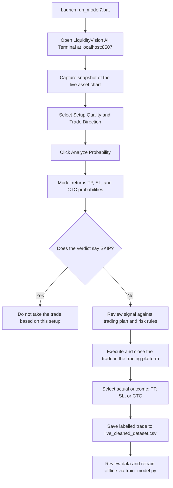
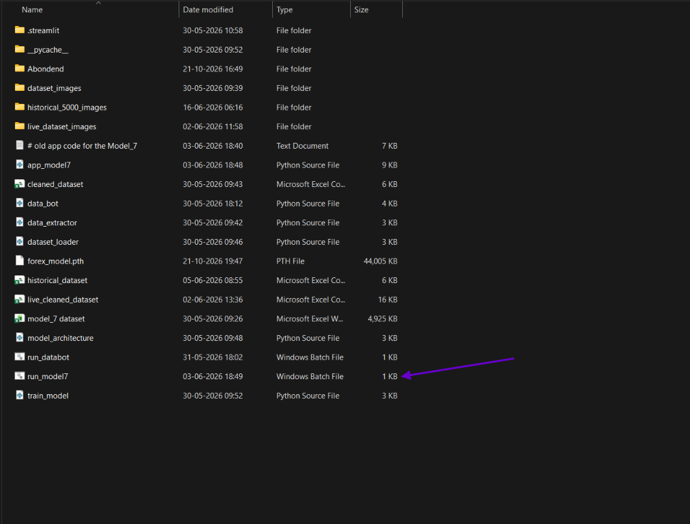
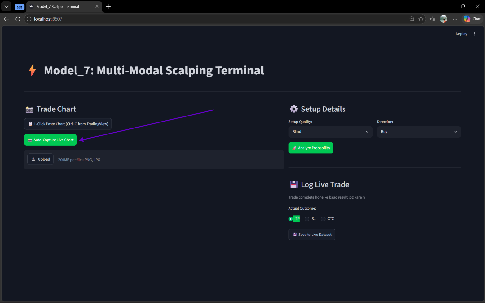
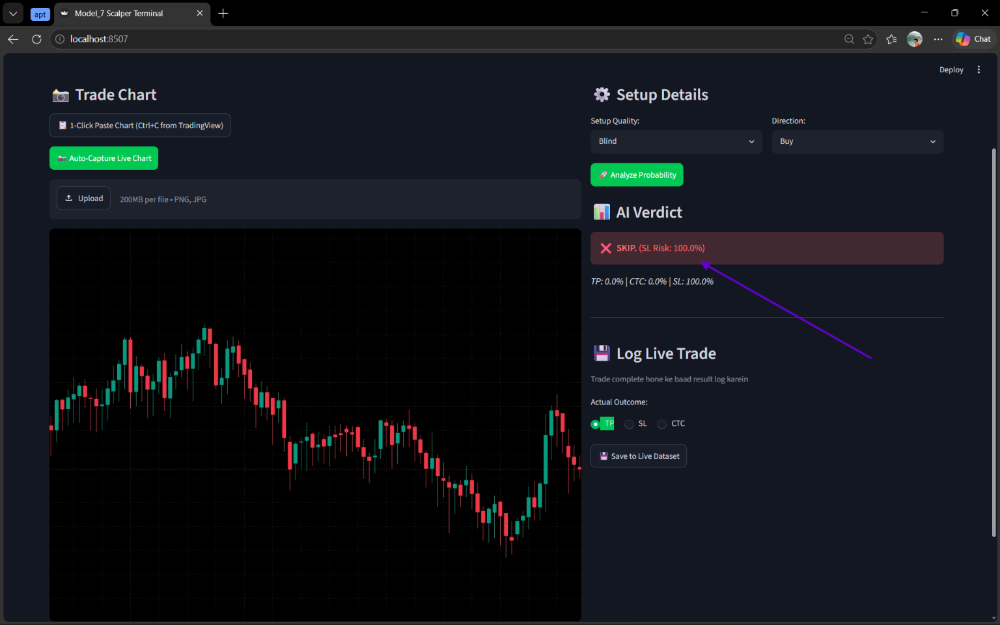
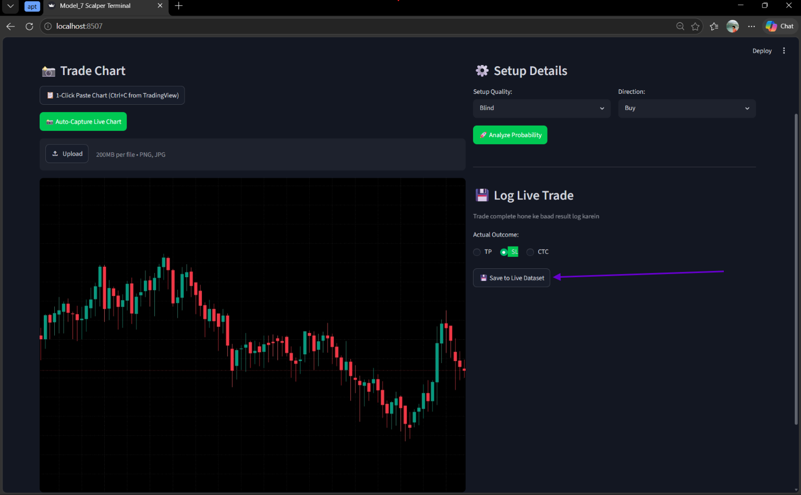
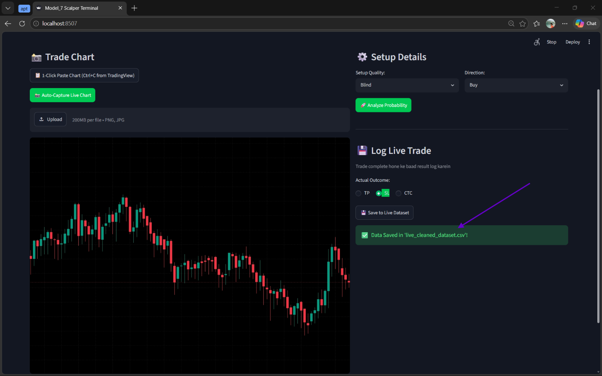

# LiquidityVision AI — Technical Documentation

> **Purpose:** A chart-image-based AI decision-support terminal for reviewing a potential scalp trade, viewing the model's estimated outcome probabilities, and saving the completed trade's actual result for future dataset improvement.

> **Important:** Model probabilities are estimates produced by the current model, not guarantees of a trade outcome or financial advice. Validate the model with out-of-sample testing and your own risk rules before relying on its output in live markets.

---

## 1. System Requirements & Dependencies

### Hardware & OS Requirements
- **Operating System:** Windows 10 or Windows 11 (64-bit) — required to run the native Windows batch launchers (`run_model7.bat`).
- **Processor & Memory:** Multi-core CPU with at least 8 GB RAM. A CUDA-compatible NVIDIA GPU is optional for local inference and recommended for model retraining.
- **Display Setup:** Active monitor displaying the charting or trading platform for automated screen capture.

### Required Software & Versions
- **Python:** Version 3.8 or higher
- **Web Interface:** Streamlit (runs locally at `http://localhost:8507`)
- **Core Libraries:** PyTorch (`torch`, `torchvision`), `pandas`, `numpy`, `Pillow`

### Dependency Installation Steps
1. Open Command Prompt inside the project folder.
2. Create and activate a Python virtual environment:
```bash
python -m venv venv
venv\Scripts\activate
```
3. Install the required dependencies:
```bash
pip install -r requirements.txt
```
4. If installing packages manually without a requirements file:
```bash
pip install streamlit torch torchvision pandas numpy pillow
```

---

## 2. Architecture & Workflow Diagram

### High-Level Components & Relationships

| Component | File / Folder | Role in System |
|---|---|---|
| **Batch Launchers** | `run_model7.bat`, `run_databot.bat` | Starts the local Streamlit terminal and data utility scripts on Windows. |
| **Application UI** | `app_model7.py`, `.streamlit/` | Hosts the LiquidityVision AI web interface at `localhost:8507`, manages screen capture, and logs trade outcomes. |
| **Inference Engine** | `model_architecture.py`, `forex_model.pth` | Defines the neural network architecture and loads saved PyTorch weights to compute outcome probabilities. |
| **Data & Training Pipeline** | `dataset_loader.py`, `data_extractor.py`, `data_bot.py`, `train_model.py` | Extracts chart images, preprocesses inputs, manages CSV records, and executes offline model retraining. |

### Data Flow & Workflow Diagram



---

## 3. Data Pipeline

### Data Sources
- **Live Chart Images:** Captured directly from the active charting window using the **Auto-Capture Live Chart** feature.
- **Setup Metadata:** User-selected categorical inputs specifying **Setup Quality** and **Trade Direction**.
- **Post-Trade Outcome Labels:** Ground-truth trade results (**TP**, **SL**, or **CTC**) recorded by the user after trade completion.

### Preprocessing Steps & Features
1. **Image Capture (`data_extractor.py`, `data_bot.py`):** Captures the live chart region and saves the image into the target image folder (`live_dataset_images/`, `dataset_images/`, or `historical_5000_images/`).
2. **Feature Transformation (`dataset_loader.py`):** Resizes and normalizes the chart snapshot into an image tensor and encodes the categorical setup features (**Setup Quality** and **Direction**).
3. **Dataset Storage:** Pairs image paths, setup features, and verified outcome labels inside structured CSV files (`live_cleaned_dataset.csv`, `model_7_dataset.csv`, `cleaned_dataset.csv`, and `historical_dataset.csv`).
4. **Offline Curation & Retraining (`train_model.py`):** Validates newly logged rows in `live_cleaned_dataset.csv` and applies a train/validation/test or chronological walk-forward split before updating model weights.

---

## 4. Model / Decision Logic

### Outcome Probability Labels

| Label | Meaning in the Interface | Decision Logic |
|---|---|---|
| **TP** | Estimated probability of reaching take-profit | Compare against **SL** and **CTC** estimates alongside your trading plan. |
| **SL** | Estimated probability of reaching stop-loss | Treat a high **SL** probability as a risk warning. |
| **CTC** | Estimated probability of the third outcome category (cost-to-cost / breakeven) | Keep the definition of **CTC** consistent across inference review and dataset labelling. |
| **SKIP** | Model recommendation to avoid the trade setup | Do not take the trade when **SKIP** is displayed. |

### Decision Rules
- **SKIP Rule:** If the verdict displays **SKIP** (for example, `SKIP (SL Risk: 100.0%)`), reject the setup immediately.
- **Non-SKIP Rule:** If the verdict does not display **SKIP**, review the setup against your independent risk-management rules before placing a trade.
- **Retraining Separation:** Saving a completed trade to `live_cleaned_dataset.csv` records the outcome for future training but does not automatically retrain `forex_model.pth` during a live session.

---

## 5. Execution Steps

### Step 1: Launch the Terminal
Double-click `run_model7.bat` (`run_model7` in the project folder if file extensions are hidden) and open `http://localhost:8507` in your browser. Keep the command prompt window open while running the app.



### Step 2: Capture the Live Chart
Open the target asset chart in your trading platform, then click **Auto-Capture Live Chart** inside LiquidityVision AI. Confirm that the captured image shows the correct asset and price action.




### Step 3: Select Setup Details and Analyse
Under **Setup Details**, choose the **Setup Quality** (e.g., `Blind`) and **Direction** (e.g., `Buy`), then click **Analyze Probability**.

### Step 4: Review the AI Verdict
Inspect the **AI Verdict** banner and the estimated **TP**, **CTC**, and **SL** probabilities. Follow the decision rules before taking any live trade.



### Step 5: Record the Actual Trade Outcome
After the trade finishes, go to **Log Live Trade**, select the actual outcome (**TP**, **SL**, or **CTC**), and click **Save to Live Dataset** to append the result to `live_cleaned_dataset.csv`.





---

## 6. Input & Output

### Expected Inputs

| Field | Type / Format | Source | Example |
|---|---|---|---|
| **Chart Image** | Image snapshot (`PNG` / `JPG`) | `Auto-Capture Live Chart` button | Live candlestick chart screenshot |
| **Setup Quality** | Categorical String | `Setup Details` dropdown | `Blind` |
| **Direction** | Categorical String | `Setup Details` dropdown | `Buy` or `Sell` |
| **Actual Outcome** | Categorical String | `Log Live Trade` selector | `TP`, `SL`, or `CTC` |

### Expected Outputs

| Output Stage | Format / Location | Fields | Example Output |
|---|---|---|---|
| **AI Verdict** | Streamlit UI Panel | Verdict status, `SL Risk %`, `TP %`, `CTC %`, `SL %` | `SKIP (SL Risk: 100.0%)` — `TP: 0.0%`, `CTC: 0.0%`, `SL: 100.0%` |
| **Saved Trade Log** | CSV Row & Saved Image | Image path, Setup Quality, Direction, Actual Outcome | Appended row in `live_cleaned_dataset.csv` and snapshot in `live_dataset_images/` |

---

## 7. Error Handling & Troubleshooting

| Common Error / Failure | Cause | Recovery Steps & Solution |
|---|---|---|
| **App does not open at `http://localhost:8507`** | Batch terminal closed, port `8507` is in use, or Python packages are missing. | Keep the batch window open, check console logs for missing modules, and run `pip install -r requirements.txt`. If port `8507` is busy, run `streamlit run app_model7.py --server.port 8508`. |
| **Blank or wrong image on `Auto-Capture Live Chart`** | Chart window is minimized, covered by another window, or on a secondary screen. | Place the charting platform in the foreground on the primary monitor and click **Auto-Capture Live Chart** again. |
| **Model load error (`FileNotFoundError` or weight mismatch)** | `forex_model.pth` is missing from the project folder or incompatible with `model_architecture.py`. | Verify `forex_model.pth` is located in the root directory and matches the model class in `model_architecture.py`. |
| **Cannot save to `live_cleaned_dataset.csv` (`PermissionError`)** | `live_cleaned_dataset.csv` is open in Excel or another program. | Close the CSV file in all external applications and click **Save to Live Dataset** again. |
| **Broken screenshot previews on GitHub** | Missing `screenshots/` folder or mismatched file names. | Keep `01-project-folder.png` through `06-dataset-saved.png` inside the `screenshots/` directory relative to `working.md`. |
