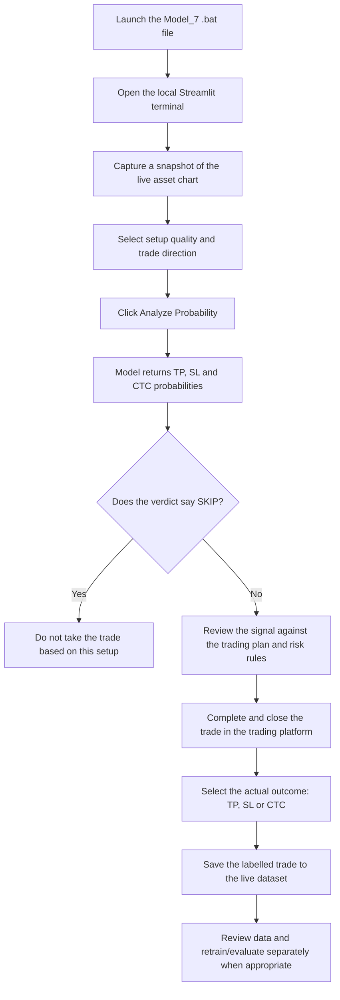

# Model_7 — Multi-Modal Scalping Terminal

> **Purpose:** A chart-image-based AI decision-support terminal for reviewing a potential scalp trade, viewing the model's estimated outcome probabilities, and saving the completed trade's actual result for future dataset improvement.

Model_7 provides a simple workflow: capture the chart, analyse the setup, review the AI verdict, and record what happened after the trade. The current interface is a local Streamlit app, shown running at `localhost:8507` in the screenshots below.

> **Important:** Model probabilities are estimates produced by the current model, not guarantees of a trade outcome or financial advice. Validate the model with out-of-sample testing and your own risk rules before relying on its output in live markets.

## Table of contents

- [How Model_7 works](#how-model_7-works)
- [Step-by-step user workflow](#step-by-step-user-workflow)
- [Understanding the AI verdict](#understanding-the-ai-verdict)
- [The feedback and dataset loop](#the-feedback-and-dataset-loop)
- [Project files at a glance](#project-files-at-a-glance)
- [Running the app on Windows](#running-the-app-on-windows)
- [Screenshots and walkthrough](#screenshots-and-walkthrough)
- [Current scope and notes](#current-scope-and-notes)

## How Model_7 works

The terminal is designed to support the trade-review process. It does not make a trade decision from the chart alone without user input: the user captures the chart, selects the setup details, runs the analysis, and reviews the verdict.



## Step-by-step user workflow

### 1. Launch the terminal

Run the Model_7 Windows batch file from the project folder. In the provided folder screenshot, Windows displays the file as `run_model7` because file extensions may be hidden; the intended file type is **Windows Batch File (`.bat`)**. The app screenshot shows the terminal open in a browser at `http://localhost:8507`.


### 2. Capture the live chart

Open the chart for the asset you are considering in your charting/trading platform. In Model_7, click **Auto-Capture Live Chart**. The app captures a snapshot of the chart for analysis, avoiding the need to manually save and upload a chart image in the normal workflow.

Check that the captured image shows the intended asset and relevant price action before moving on.


### 3. Select setup details and analyse

In **Setup Details**, select the setup quality and direction that correspond to the trade being evaluated. The screenshots show `Blind` and `Buy` selected as an example. Then click **Analyze Probability**.

The model analyses the chart input and displays an **AI Verdict** with estimated probabilities for the outcome labels used by the app.

### 4. Read the AI verdict

The result panel displays the verdict and the TP, CTC and SL probability values. For example, one supplied screenshot shows `SKIP (SL Risk: 100.0%)`, with `TP: 0.0%`, `CTC: 0.0%` and `SL: 100.0%`. This is an example output from that particular run; it is **not** evidence of overall model accuracy or expected performance.


**Decision rule described for the current workflow:**

- **SKIP:** do not take the trade based on this model verdict.
- **A non-SKIP verdict:** continue only after reviewing the setup, execution conditions and your risk-management rules. A non-SKIP result is not a guarantee of profit.

### 5. Record the actual trade outcome

After the trade has completed, return to **Log Live Trade** and select the outcome that actually occurred:

- **TP** — the trade reached take-profit.
- **SL** — the trade reached stop-loss.
- **CTC** — the third outcome label provided by the application. Its exact definition should be documented in the model's code/business rules so that every dataset label is interpreted consistently.

Then click **Save to Live Dataset**.


When saving succeeds, the interface displays a confirmation message. In the supplied screenshot, the confirmation says that data was saved in `live_cleaned_dataset.csv`.


## Understanding the AI verdict

| Label | Meaning in the interface | How to use it |
|---|---|---|
| **TP** | Estimated probability of the trade reaching take-profit | Compare it with the SL/CTC estimates and the complete setup. |
| **SL** | Estimated probability of the trade reaching stop-loss | Treat a high SL probability as a warning, not as a standalone guarantee. |
| **CTC** | Estimated probability of the app's third outcome category | Confirm the meaning of CTC in the implementation and use the same definition when labelling actual outcomes. |
| **SKIP** | The model's recommendation to avoid the setup | Do not take the setup based on this verdict. |

The displayed probabilities should be interpreted as model outputs. Their usefulness depends on factors such as data quality, the similarity between live charts and training examples, validation methodology, and whether the model has been tested on unseen trades.

## The feedback and dataset loop

One important part of Model_7 is recording the **actual** result after a trade. The analysis output is a prediction; the saved label records what happened in reality. Those labelled examples can be inspected, cleaned and considered for future model training and evaluation.

1. Capture a chart and run the current model.
2. Let the trade complete, if one was taken.
3. Record the actual outcome using the outcome selector.
4. Save the record to the live dataset.
5. Review dataset quality and label consistency before using new rows for training.
6. Retrain and evaluate the model as a separate, controlled step.

**Saving a trade does not, by itself, mean the model has been retrained.** Run the project's training pipeline separately if that is how the current implementation is configured. Before replacing model weights, use an appropriate train/validation/test split or chronological walk-forward evaluation to reduce the risk of data leakage and misleading performance estimates.

## Project files at a glance

The following names are visible in the current project-folder screenshot. Descriptions are based on filenames and the visible app workflow; check each file's implementation for its exact responsibilities.

| File or folder | Apparent role |
|---|---|
| `.streamlit/` | Streamlit app configuration. |
| `app_model7.py` | Main Python app file suggested by its name. |
| `model_architecture.py` | Model architecture definition suggested by its name. |
| `train_model.py` | Model training script suggested by its name. |
| `dataset_loader.py` | Dataset-loading utilities suggested by its name. |
| `data_extractor.py` | Data-extraction utilities suggested by its name. |
| `data_bot.py` | Data-related script; exact function should be verified in code. |
| `run_model7` (`.bat`) | Windows batch launcher for Model_7, as shown in the folder view. |
| `run_databot` (`.bat`) | Windows batch launcher for the data bot, as suggested by its filename. |
| `forex_model.pth` | Saved PyTorch model weights. |
| `model_7_dataset` | Main dataset file shown in the folder view. |
| `cleaned_dataset` | Cleaned dataset file shown in the folder view. |
| `historical_dataset` | Historical dataset file shown in the folder view. |
| `live_cleaned_dataset` | Live dataset file used by the save confirmation shown in the app. |
| `dataset_images/` | Image dataset directory. |
| `historical_5000_images/` | Historical chart-image directory, as suggested by its name. |
| `live_dataset_images/` | Live chart-image directory, as suggested by its name. |
| `Abondend/` | Additional folder visible in the project view; document its purpose once confirmed. |
| `# old app code for the Model_7` | Text file containing older app code, based on its displayed filename. |

> **Repository hygiene:** avoid committing private trading credentials, API keys, account identifiers, or other secrets. Consider whether datasets and chart screenshots contain sensitive information before publishing them publicly. Model weight files and large datasets can make a repository very large; consider Git LFS or a separate data/model-artifact location if needed.

## Running the app on Windows

1. Open the project folder.
2. Double-click the Model_7 batch file (`run_model7` in the screenshot; check the actual filename and extension on your machine).
3. Let the command window start the app. Keep that window open while using the terminal.
4. Open the local URL printed by the launcher. The supplied screenshots show `http://localhost:8507`.
5. Follow the workflow above to capture a chart, analyse it, and record the actual outcome.

If the browser does not open automatically, check the batch file's console output for the local Streamlit URL and any Python dependency or runtime errors. The exact setup commands and dependency versions should be documented in a `requirements.txt` or environment file for repeatable installation.

## Screenshots and walkthrough

The screenshots above are included in the adjacent `screenshots/` directory and linked with relative paths. Keep the directory structure below when adding this documentation to GitHub, so the images render in the GitHub Markdown viewer:

```text
your-repository/
├── WORKING.md
└── screenshots/
    ├── 01-project-folder.png
    ├── 02-terminal-home.png
    ├── 03-chart-captured.png
    ├── 04-ai-verdict.png
    ├── 05-log-trade-outcome.png
    └── 06-dataset-saved.png
```

## Current scope and notes

- Model_7 is presented here as a **chart-analysis and trade-outcome logging workflow**. The screenshots do not show automatic order execution, so this documentation does not claim that the app places or manages trades automatically.
- The app's probability estimates and `SKIP` verdict should be validated against properly labelled, unseen data before being used in real trading decisions.
- Keep TP/SL/CTC definitions consistent between the model output, actual-outcome selector and stored dataset.
- Update this document whenever the workflow, model architecture, dataset schema or launcher changes.
